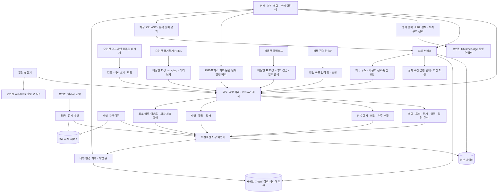

# 01. 아키텍처와 모듈 간 계약

상위 계획: [plan.md](../plan.md) · 데이터 계약: [02](02-data-states.md)

논리 구조 제안이다. 아래 Repository, Command, Event는 역할 이름이며 특정 라이브러리나 언어 선택이 아니다. 현행 구조를 조사한 뒤 이 경계를 어디에 둘지 결정한다.

## 1. 시스템 경계

외부 서버는 필요 없다. 기본적으로 실행 주체는 사용자 앱 프로세스 하나이며 여러 창을 관리한다. 보조 프로세스가 필요한 UI 기술을 선택하더라도 원본 쓰기 책임은 한 서비스로 모은다. 현재 앱이 다중 인스턴스 구조라면 기존 동작을 조사하고 잠금 또는 IPC를 설계한다.

## 2. 모듈 책임과 금지 의존

| 모듈 | 책임 | 직접 해서는 안 되는 일 |
|---|---|---|
| Presentation | 화면·선택·접기·스크롤·편집 초안 | 화면마다 별도 원본 파일 저장 |
| Application | 명령 검증·중복 방지·저장 순서·권한 정책 호출 | 보안 정책을 우회해 파일 열기 |
| Domain | 부모·관계·완료·일정·알림 불변조건 | OS 창 위치나 편집기 객체에 종속 |
| Persistence | 트랜잭션·revision·제약·스키마 버전 | 화면 이벤트만 믿고 무검증 쓰기 |
| AssetStore | 허용 이미지 준비·확정·해시·수명주기 | 원격 URL을 이미지로 자동 다운로드 |
| SearchProjection | 원본에서 색인 재생성·증분 갱신 | 색인을 유일한 업무 데이터로 사용 |
| WindowAdapter | 창 열기·배치·최소화 복원·포커스 시도 | 알림 확인 상태 임의 변경 |
| ReminderWorker | 도래 조회·claim·재시도·확인 상태 처리 | 메모리 타이머만으로 알림 보관 |
| HolidayProvider | 활성 패키지·보정·검증 범위 조회 | 인터넷이 있다고 자동 크롤링 |
| Operations | 이전·백업·복원·진단·배포 검증 | 작업 중 원본 훼손·본문 로그 기록 |
| RecurrenceEngine | 유한 범위 회차 생성·예외·원래 순서 분할·정규 슬롯 매핑 | 무한 미래 전개, 실제 이동 날짜로 이후 경계 판정 |
| LabelService | 색상·이름·대표 순서·할당·any/all 필터 | 색 수정으로 모든 메모 본문 수정시각 변경 |
| BookmarkImporter | 비실행 HTML 파싱·폴더·인코딩·중복·반입 원자 확정 | HTML 렌더러에서 실행·URL/아이콘 자동 접속 |
| BrowserLauncher | 승인된 설치 탐지·지정 Chrome/Edge·URL 정책·구조화 인수 | 원문 URL로 셸 문자열 조립, 임의 실행파일 지정 |
| TablePasteService | 허용 클립보드·격자/병합·원자 붙여넣기·표 구조 검증 | 보호 문서 열기·OLE 활성화·원격 자원 다운로드 |
| OutlineInputResolver | 문단 시작 기호·2칸 단계·Enter 연속·상위 계열 복귀·수동 보정 | IME 중간 입력 변환, 자식 Note parent_id 변경 |
| TableProjection | 본문 table_id의 모아보기·셀 원문 위치·버전 추적 | 독립 표 사본을 업무 원본으로 수정 |
| QuickCapture | 실행 중 전역 키·입력창 재사용·명시 저장·수집함 분류 | 창 열기만으로 Note 생성, 무단 키/클립보드 감시 |
| SavedViewService | 허용 조건 AST·상대 날짜·명시 정의 저장·교차 화면 | SQL 실행·무효 참조 삭제로 조회 범위 자동 확대 |
| ChecklistService | 본문 항목·진행률·정규 회차 snapshot/체크 상태 | 체크 전부를 전체 완료로 전파·전날 체크 복제 |
| WorkflowStatus | Note/회차 진행 상태·완료와 독립 | 대기/보류만으로 기한·알림 해제 |
| OverlapService | 필터 독립 실제 시간 교차·유한 범위 경고 | 경고를 쓰기 제약으로 취급·일정 자동 재배치 |
| JournalService | 최소 이벤트 후보·coverage·사용자 편집·멱등 Note 저장 | 전체 본문 버전 수집·메모별 이력 UI·자동 보고 발송 |

## 3. 공통 명령 봉투

모든 수정은 `command_id`, `command_type`, `target_id`, `expected_revision`, `payload`로 요청한다. 여러 엔터티를 바꾸면 각 대상의 기대 revision을 담는다. 창 ID는 요청 출처를 구별하기 위한 값이며 데이터 소유자가 아니다. `command_id`는 재시도 시 동일하게 유지한다.

처리 순서:

1. 요청 형식·크기·세션·허용 동작을 검사한다. 외부 입력은 내부 창에서 왔어도 신뢰하지 않는다.
2. 원본과 현재 revision을 읽고 명령의 의미·상태·정책을 검증한다.
3. 하나의 쓰기 트랜잭션에서 원본 변경, revision 증가, 후속 작업 기록, 명령 결과를 확정한다.
4. 커밋 성공 뒤 저장 성공을 응답한다. 실패하면 원본에 부분 변경을 남기지 않는다.
5. 커밋된 변경 번호와 대상 ID로 각 창·색인·알림 스케줄을 갱신한다. 이벤트 본문에 업무 내용 전체를 중복 저장하지 않는다.

성공 응답에는 새 revision과 최종 원본 상태 또는 조회 토큰을 포함한다. 동일 command_id가 재전송되면 기존 확정 결과를 반환하고 관계·일정·알림 발생 건을 중복 생성하지 않는다. command_id를 다른 payload로 재사용하면 오류로 처리한다. 명령 기록 보존 기간은 복구·용량 정책으로 정하되 기간을 넘긴 재전송은 현재 revision과 고유 제약으로 다시 보호한다.

### 오류 계약

| 코드 | 의미 | UI 동작 |
|---|---|---|
| VALIDATION | 형식·시간 범위·필수 값 오류 | 해당 필드와 수정 방법 표시 |
| CONFLICT | 기대 revision과 원본 불일치 | 새 원본과 내 초안을 모두 보존, 비교·재적용 |
| NOT_FOUND / TRASHED | 삭제·휴지통 등 상태 변화 | 원본 위치·복원 동선 안내; 초안 보존 |
| POLICY_DENIED | 사내 정책 또는 허용 형식 아님 | 차단 이유와 허용 대안; 우회 제안 금지 |
| STORAGE_FULL / IO_ERROR | 저장공간·권한·디스크 오류 | 미저장 표시, 재시도·텍스트 복사·승인된 복구 위치 |
| RECOVERY_REQUIRED | 손상·버전 불일치 | 읽기 전용 또는 복구 화면; 자동 빈 저장소 생성 금지 |

## 4. 다중 창 편집

- 창의 초안, 현재 커서, 접기 상태는 화면 상태다. 저장된 Note와 분리한다.
- 동일 메모가 이미 별도 창에 있으면 기본 동작은 그 창 활성화다. 본창과 분리창 동시 편집은 가능하되 둘 다 revision 검사를 따른다.
- 저장 중 생긴 편집은 전송한 초안과 구별한다. 응답이 왔다고 최신 타이핑까지 저장됐다고 표시하지 않는다.
- 조합 중인 한글을 자동저장 경계에서 분해하거나 강제 확정하지 않는다. 편집기 조합 이벤트를 존중한다.
- 서로 다른 필드라도 기본은 원본을 다시 읽고 재적용한다. 검증 없는 마지막 쓰기 우선 정책은 쓰지 않는다. 필드 단위 병합을 도입하려면 충돌 판정·검증·테스트를 별도 추가한다.
- 이벤트를 놓친 창은 변경 번호 차이를 감지해 원본을 다시 조회한다. 초안이 없는 창은 즉시 갱신하고, 초안이 있는 창은 충돌 표시와 저장 가능 여부를 보여준다.
- 창 닫기는 미저장 초안·진행 중 이미지 입력이 있으면 저장·재시도·초안 보존 등 선택 경로를 제공한다. 조용히 버리지 않는다.

표 붙여넣기·행열 변경·문단 기호 변환도 같은 본문 편집 트랜잭션으로 처리한다. 한 번의 붙여넣기를 셀별 Note 저장으로 쪼개 부분 커밋하지 않는다. 문단 기호 인식→단계→표시 번호→커서 이동은 한 입력 동작이며 플러그인이 Enter를 두 번 처리하지 않게 한다. 포커스 라우터는 IME 조합을 먼저 처리하고 표 셀의 Tab/Shift+Tab 이동을 문단 들여쓰기보다 우선한다. 해당 키를 처리한 계층은 소비 결과를 반환한다.

## 5. 원본과 파생 데이터

원본은 메모 본문·구조·관계·일정·알림 상태·자산 메타데이터다. 검색 결과, 본문에서 추출한 URL 목록, 썸네일은 파생 데이터다. 색인 손상은 원본 유실과 구분하고 재생성할 수 있어야 한다.

커밋과 화면 이벤트 사이에 앱이 종료되어도 후속 처리를 복원할 수 있도록 내부 변경 로그 또는 트랜잭션 아웃박스를 둔다. 제품이 이미 동등한 메커니즘을 제공하면 재사용한다. 소비자는 변경 번호·대상 revision으로 중복 적용을 막는다. 처리 완료 전에 작업 기록을 제거하지 않는다.

검색 색인의 지연과 실패를 숨기지 않는다. 최신 원본 조회·임시 부분 검색·재색인 안내 중 가능한 방법을 제공한다. 색인 갱신 실패가 본문 저장 실패인 것처럼 보이지 않게 한다.

반복 캘린더 조회는 일반 규칙 회차에 더해 실제 날짜로 들어오는 예외를 별도 범위 조회하고 원래 날짜에서 나간 예외를 제거한다. 발생 ID로 합치되 날짜가 같은 다른 회차는 병합하지 않는다. 필터·메모 목록은 distinct note_id로, 달력은 occurrence로 표시한다. 라벨 이름·색상 변경은 공유 Label 변경 이벤트로 갱신하여 메모·색인 전체를 불필요하게 다시 저장하지 않는다. 즐겨찾기는 원본 Bookmark 목록이며 본문 URL 파생 색인과 구별한다.

표·행·셀·문단 ID는 body_doc의 원본이다. TableUsageIndex와 셀 검색·이미지/링크 사용 위치는 파생 데이터다. 추출기는 셀의 실제 저장 원점만 순회하여 병합 범위의 텍스트를 중복 계산하지 않는다. 모아보기는 stable table/cell anchor를 전달해 최신 원본을 열고, 행열 이동 후에도 배열 인덱스만으로 다른 셀을 열지 않는다. 표 삭제·휴지통·복원·실행취소는 동일 원본 변경 기록을 통해 모든 투영을 갱신한다.

## 5.1 표 붙여넣기와 문단 입력 경계

허용 클립보드 데이터 확인 → 비실행 파싱 → 안전 노드·행열·span·크기 검증 → 필요 시 손실/변환 미리보기 → 새 안정 ID 부여 → 본문 초안에 단일 작업 적용 → 공통 저장·revision 검사 → 색인 갱신 순서다. 외부 파일을 열어 클립보드를 대신 채우거나, 이미지뿐인 표를 OCR로 바꾸는 경로는 없다. 병합·여러 줄·빈 셀을 명시 처리하고 실패 시 붙여넣기 전 본문과 선택을 보존한다.

문단 단계는 숫자 metadata이며 실제 공백을 중복 삽입하지 않는다. Enter는 현재 단계의 다음 기호, 수동 새 기호는 기본 직전 관련 문단 +1단계, 같은 계열의 상위 연속번호는 그 상위 단계, Shift+Tab은 -1단계다. 우선순위·기호 모호성·수동 보정 잠금·표 셀 단축키는 [12](12-outline-indentation.md)를 따른다. 전체 문서를 재해석하는 정규식 치환으로 사용자의 기존 번호를 조용히 고치지 않는다.

## 6. DB와 이미지 파일의 원자성 한계

파일 시스템과 DB 사이에 하나의 트랜잭션이 있다고 가정하지 않는다. 기본 흐름은 다음과 같다.

1. 입력 정책·파일 크기·디코딩 크기·형식을 검증하고 승인된 준비 영역에 내부 생성 이름으로 쓴다.
2. 해시·길이를 계산하고 파일 쓰기·닫기를 완료한다. 같은 볼륨에서 최종 위치로 안전하게 확정 가능한지 확인한다.
3. 최종 관리 파일을 먼저 준비한 뒤 원본 트랜잭션에서 Asset과 본문 참조를 함께 확정한다. 저장 성공은 참조와 파일이 모두 유효할 때만 표시한다.
4. 3 직전에 실패하면 원본이 참조하지 않는 파일만 남는다. 시작 시 준비 기록과 참조를 대조해 정리하거나 다시 시도한다.
5. 참조 중인 자산은 휴지통·복원 기간·백업 생성 중에는 지우지 않는다. 정리는 참조 조회와 유예 기간으로 수행한다.

정책상 이미지 재인코딩·메타데이터 제거가 허용되지 않으면 임의 변환하지 않는다. 저장·백업 파일에 사내 보안 속성이 유지되는지 실제 제품으로 검증한다. 이미지 입력 실패 때문에 기존 본문이 빈 값으로 교체되지 않아야 한다.

## 7. 알림 실행 경계

알림 발생 건을 원본 저장소에 남기고 도래 건을 조회한다. 프로세스 재시작·절전 복귀·시스템 시각 변경 시 다시 조회한다. 화면 표시의 물리적 정확히 한 번 전달은 보장하지 않는다. 내부 ID로 중복 UI를 합치고 사용자 확인을 영속 저장하는 **재전달 가능한 처리**를 사용한다.

명령 처리에서 완료·휴지통·일정 변경·알림 해제를 확정할 때 영향을 받는 occurrence를 취소·재생성한다. generation이 이전인 실행 요청은 표시 직전 재검사한다. OS 표시 후 확인 저장 전 종료되면 같은 알림이 재전달될 수 있다. 이를 데이터 손실보다 나은 복구 동작으로 문서화하고 동일 ID로 병합한다.

정기 일정은 `(lineage_id,global_ordinal)` 슬롯별로 알림을 생성한다. 알림 설정 generation과 개별 알림 전달 delivery_revision을 분리하고, 이번만 이동 때문에 전체 회차의 확인·미루기를 초기화하지 않는다. 이후 분할은 기존 구간 종료·새 구간 생성·예외/상태/별칭/작업 기록을 하나의 트랜잭션으로 확정한다. OS 전달은 커밋 뒤 수행하며 표시 직전 슬롯·규칙·예외·완료·두 버전을 검사한다. 생성 horizon·복귀 watermark는 [09](09-recurring-schedules.md)를 따른다.

## 7.1 즐겨찾기 실행과 무통신 경계

데이터 읽기·검색·미리보기·반입은 오프라인이다. 즐겨찾기 실행만 사용자의 명시 행동에 따라 승인된 외부 브라우저로 URL을 전달한다. 실행 성공은 사이트 로딩 성공을 뜻하지 않는다. 앱이 링크 유효성을 확인하려고 먼저 접속하거나 폴백 브라우저를 몰래 실행하지 않는다. 설치 경로는 OS의 신뢰 가능한 등록/승인 설정에서 확인하고 HTML·메모 내용에서 받지 않는다. 명령줄이 필요한 API라도 승인된 라이브러리의 인수 직렬화와 인용 규칙을 검증하고 셸을 끼우지 않는다. 자세한 계약은 [10](10-bookmarks-labels.md)에 둔다.

## 7.2 수집·보기·체크·진행·겹침·일지 경계

빠른 입력은 기존 앱 프로세스의 단일 창·명령 처리에 연결한다. 단축키는 실행 중에만 등록하고 충돌·보안 거부를 표시한다. 저장 성공 전에 초안을 지우지 않으며 Note 생성과 inbox 분류·최소 생성 이벤트를 함께 확정한다. 날짜/라벨 지정과 정리 완료를 구별한다.

저장 보기의 정의와 현재 화면 필터는 분리한다. 하나의 조회 평가 기준일·시간대·조건 revision을 목록/개수/캘린더에 공유한다. 잘못된 조건 참조는 오류로 유지하고 전체 조회로 확대하지 않는다. 겹침 검사는 현재 표시 필터를 사용하지 않고 같은 저장소의 유효 시간 구간을 조회한다. 결과에 검사 범위·revision·부분/실패 상태를 담고 저장 전후 재계산하되 저장을 막지 않는다.

체크는 단발 본문 상태와 반복 정규 슬롯의 상태를 분리한다. 첫 회차 상호작용/완료 시 체크 항목만 snapshot으로 확정해 이후 템플릿 변경이 진행률 분모를 바꾸지 않게 한다. 전체 본문 버전 보관을 뜻하지 않는다. 진행 상태는 완료·라벨·수집함·알림과 독립이며 해당 범위 revision만 갱신한다.

업무일지는 원본 명령과 함께 확정한 created/completion_changed/schedule_moved 이벤트만 읽는다. 이벤트·최종 보고 메모는 원본, 후보 목록·겹침 결과·체크 집계는 재생성 가능한 투영이다. 사용자가 편집한 JournalDraft는 보호할 원본 초안이며 새 후보를 계산했다고 덮지 않는다. 동일 draft 저장은 같은 Note를 반환하고 source_kind=journal은 후보에서 제외한다. 최소 이벤트에 이전 본문·모든 편집 동작을 기록하거나 메모별 변경 이력 화면을 추가하지 않는다. 상세 계약은 [13](13-capture-views-checklists.md)·[14](14-status-overlap-journal.md)에 둔다.

## 8. 저장소·동시 실행·이벤트 정책

로컬 저장 위치는 쓰기 가능 여부와 사내 정책을 조사한 뒤 정한다. 실행 파일 디렉터리, 공유 폴더, 네트워크 드라이브, 개인 클라우드 동기화 폴더를 기본으로 가정하지 않는다. 지원하지 않는 저장 경로는 명시적으로 차단·안내한다.

두 번째 실행은 단일 인스턴스 잠금을 확인하고 기존 프로세스에 허용된 열기 요청만 전달한다. IPC가 있다면 현재 사용자·스키마·요청 크기를 검사한다. 임의 파일 경로나 명령 실행용 통로로 만들지 않는다. 멈춘 잠금은 실제 프로세스 소유 확인 뒤 회복하며 단순 시간 만료만으로 동시에 쓰기 시작하지 않는다.

트랜잭션 충돌·장시간 작업은 UI 스레드를 막지 않고 진행 상태·취소 가능 구간을 표시한다. 백업·이전·재색인은 취소 시 원본 불변조건을 유지한다. DB 종류에 따른 쓰기 직렬화·잠금·온라인 백업 방식은 조사 후 확정한다.

## 9. 시작·종료·장애 복구 순서

시작: 인스턴스 확인 → 저장소 경로·권한·버전 확인 → 비정상 종료·준비 파일 검사 → 필요한 이전/읽기 전용 분기 → 저장소 개방 → 놓친 알림 조회 → 색인 차이 복구 → 화면 상태 복원.

정상 종료: 새 수정 접수 중지 → 조합·편집 초안 저장 또는 명시적 보존 → 진행 중 명령 결과 확정 → 알림 claim 정리 → 창 상태 저장 → 저장소 닫기. 종료 제한 시간 때문에 미완료 상태가 생기면 다음 시작의 복구 대상에 남긴다.

손상된 저장소를 새 빈 저장소로 덮지 않는다. 복사본 진단, 백업 복원, 읽기 전용 추출 중 허용된 경로를 제공한다. 로그에는 명령 종류·익명 ID·오류코드·지연 정도만 남기고 본문·제목·URL·이미지·보안 경로는 기본 제외한다.

## 10. 수용·설계 검증

| ID | 시나리오 | 통과 조건 |
|---|---|---|
| ARCH-01 | 같은 command_id 두 번 전달 | 원본 변경 1회, 같은 확정 결과 |
| ARCH-02 | 두 창이 같은 revision으로 서로 다른 본문 저장 | 먼저 확정한 원문 보존, 다른 초안 충돌 표시 |
| ARCH-03 | 커밋 후 이벤트 발행 전 강제 종료 | 재시작 후 원본·색인·화면·알림 일치 |
| ARCH-04 | 자산 파일 확정 후 DB 커밋 전 중단 | 미참조 파일 복구·정리, 깨진 본문 참조 없음 |
| ARCH-05 | 디스크 가득 참·권한 박탈 | 성공 오표시 없음, 초안 보존, 기존 원본 접근 유지 |
| ARCH-06 | 네트워크 차단·원격 이미지 포함 붙여넣기 | 자동 다운로드 없음, 허용된 텍스트만 안전 입력 |
| ARCH-07 | 2차 실행·동시 실행 시도 | 두 쓰기 소유자 발생 안 함 |
| ARCH-08 | 반복 이후 이동의 각 커밋 경계에서 중단 | 기존/새 구간 중 일관된 한 결과, 상태·별칭·알림 부분 이관 없음 |
| ARCH-09 | 반복 예외가 원래 조회 월 밖에서 해당 월로 이동 | 대상 범위에 한 번 표시, 원래 위치 중복 없음 |
| ARCH-10 | 즐겨찾기 HTML에 스크립트·원격 이미지·셸 특수문자 URL | 반입 통신·실행 없음, 명시 클릭 시 승인 브라우저 인수만 전달 |
| ARCH-11 | 라벨 색 수정·삭제 중 다른 창에서 할당 변경 | revision 충돌 처리, 메모 보존·필터/색띠 일치 |
| ARCH-12 | 표 파싱·자산 준비·본문 커밋 경계 중단 | 원래 본문 또는 완전한 새 표, 부분 행열·깨진 자산 참조 없음 |
| ARCH-13 | Enter·Shift+Tab의 IME/셀/문단 이벤트 경합 | 한 명령만 적용, Enter 같은 단계·셀 이동·2칸 보정 일치 |
| ARCH-14 | 표 이동/복사/삭제/복원 후 모아보기·색인 | 원본 ID·최신 revision으로 올바른 위치 이동, 복사는 새 ID |
| ARCH-15 | 빠른 메모 저장·첫 회차 체크·일지 저장 경계 중단 | Note/분류·snapshot/상태·일지 저장 연결 원자 확정, 중복 없음 |
| ARCH-16 | 무효 저장 보기·상대 날짜·숨긴 일정 겹침 | 조건 오류 숨김 없음, 같은 평가일·필터 독립 검사, 저장 허용 |

단위 검증은 규칙·명령 경계에, 통합 검증은 실제 저장소·파일 시스템에, UI·알림 검증은 사내와 동등한 Windows에 배치한다. 모의 객체만으로 OS·DRM 적합성을 승인하지 않는다.
