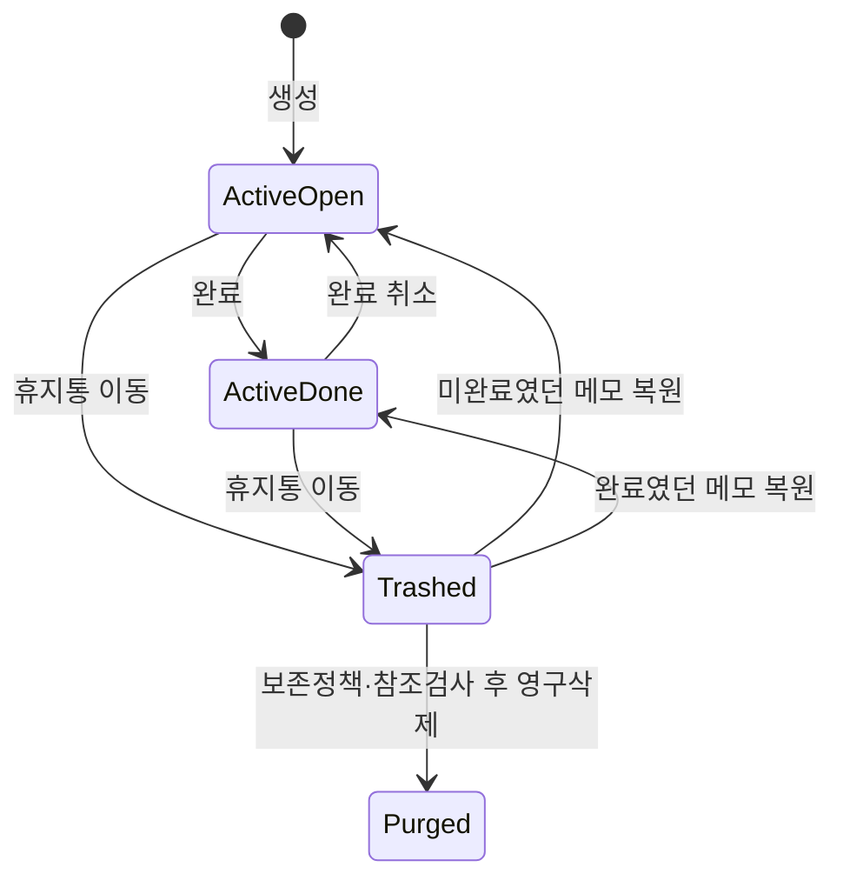
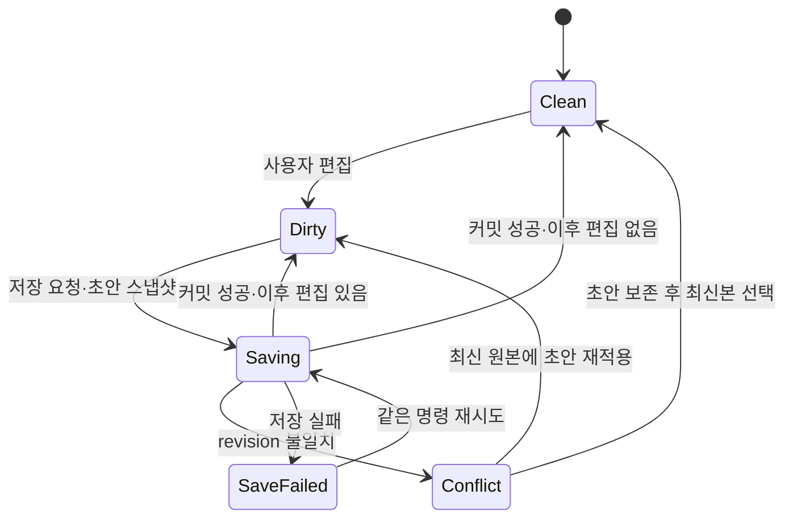
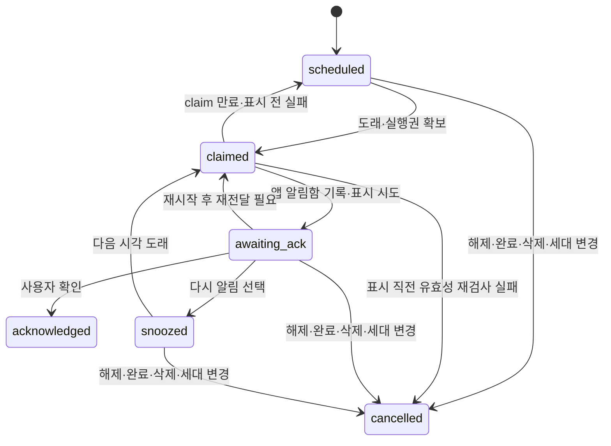

# 02. 논리 데이터 모델과 상태기계

> 최신 범위: [23 프로젝트 단일 분류·아이콘 도구](23-projects-icon-toolbar.md)에 따라 라벨과 `LABEL-*` 계약은 폐기되었다. 이 문서의 라벨 모델·필터·시험은 과거 설계 참조이며 구현하지 않는다. 프로젝트와 메모 자체 색상, 위키/정리 폴더는 유지한다.

> v1.5 변경: 이 문서의 단일 부모 제한 및 parent_id 기반 종속 계약은 [17 복수 부모 DAG·위키](17-dag-board-wiki.md)로 교체한다. 기존 필드를 DAG 간선으로 이전하는 절차를 적용한다. 관리함의 최신 역할과 화면은 17/19를 따른다.

상위 계획: [plan.md](../plan.md). 아래는 현행 데이터 분석 후 매핑할 **논리 계약**이다. SQL·파일 형식·라이브러리 선택은 확정하지 않았다. 기존 필드와 ID를 보존할 수 있으면 우선 활용한다.

## 1. 공통 규칙

- 식별자는 제목·날짜·화면 경로와 분리한 안정 ID다. 내부 링크는 ID를 사용한다. 새 ID의 생성 방식은 충돌 위험·기존 형식 조사 후 결정한다.
- 시각은 UTC의 명확한 단위·정밀도를 직렬화 계약에 적는다. 새 메모의 `created_at_utc`는 자동 설정 후 일반 수정으로 바뀌지 않는다. 이전 데이터의 생성시각이 미상일 때만 null을 허용하고 `created_time_status=unknown` 및 원시값·출처를 별도 보존한다. `imported_at_utc`는 생성시각과 다르다. 잘못된 PC 시각은 로그·표시로 감지하고 조용히 과거 기록을 덮어쓰지 않는다.
- 날짜만 있는 값은 `YYYY-MM-DD` 같은 civil date로 저장한다. UTC 자정으로 바꿔 저장하지 않는다. `end_date_exclusive`는 표시 종료일 다음 날이다.
- 새 변경은 정수 revision을 증가시킨다. 앱이 부여하는 시간만으로 충돌 순서를 판단하지 않는다. 메모 내용 변경과 화면 열기·검색·정렬 변경을 구별한다.
- `null`은 없음이다. 0·빈 문자열·특정 날짜를 미지정의 대체값으로 쓰지 않는다. 날짜·시간의 유효 범위와 입력 상한은 기존 분포와 UI 계약으로 정한다.

## 2. 엔터티

### Note — 메모 원본

| 필드 | 의미·검증 |
|---|---|
| id | 안정 ID, 모든 화면·링크·일정의 기준 |
| parent_id | 루트면 null; 다른 Note 1개; 자기 자신·순환 불가 |
| title | 유니코드 제목, 비어 있을 때 UI에만 ‘제목 없음’ 표시 제안 |
| body_doc | 버전 있는 안전한 문서 구조; 문단 기호/단계·표/셀·텍스트·URL·Asset ID 참조 |
| body_format_version | 편집 문서 해석·이전 버전 |
| revision | 본문·제목·부모·완료·휴지통 등 원본 변경 버전 |
| created_at_utc / updated_at_utc | 생성·업무 내용 변경 시각; 이식 시 출처·정밀도 별도 보존 |
| completed_at_utc | 미완료 null / 완료 시각; 휴지통과 독립 |
| workflow_status | todo / in_progress / waiting / on_hold; 완료 여부·라벨·알림 설정과 독립 |
| collection_state | inbox / filed; 미정리 수집함 여부, 부모·라벨·일정과 독립 |
| source_kind | normal / quick_capture / journal / migration 등 허용 enum; 일지 자신을 재수집하지 않도록 출처 구분 |
| trashed_at_utc / trash_batch_id | 활성 null / 묶음 휴지통 시각·식별자 |
| sort_key | 수동 정렬의 안정 순서; 자동 정렬 필드와 분리 |

이전 특수값: 기존 메모가 완료·휴지통 상태인 것은 확인되지만 해당 시각이 없을 수 있다. 이 경우 null을 넣어 미완료·활성으로 바꾸거나 현재 시각을 실제 완료·삭제시각처럼 넣지 않는다. `MigrationStaging`에 원래 상태·원시값·미확인 사유를 보존하고 정상 활성화를 보류한다. 실제 표본에 이런 값이 있으면 S1에서 상태와 시각을 분리하는 명시적 필드 확장 또는 확인된 무손실 매핑을 결정하고 모든 조회·이전·수용기준을 갱신한다. 현재 timestamp 기반 기본 모델로 그대로 옮길 수 있다고 가정하지 않는다. 미확인 항목은 이전 대조표의 보류 건수에 포함한다.

본문의 최소 구조 예: `document(version, blocks[])`, `paragraph(paragraph_id,runs[],outline?)`, `text(value, marks)`, `link(label, url)`, `note_link(note_id, label)`, `image(asset_id, alt, width_hint)`, `table(table_id,caption,rows[])`. 모아보기·검색에서 원문으로 이동할 수 있도록 블록·참조에 안정 anchor를 둔다. 실제 현행 편집기 구조와 변환 가능성을 확인한 뒤 확정한다. 외부 HTML·JavaScript를 그대로 신뢰해 저장·실행하지 않는다. 구현상 DOM 위치를 영속 식별자로 사용하지 않는다. 내부 링크의 영구삭제 대상은 tombstone으로 표시하고 동명 메모로 자동 연결하지 않는다.

v1.3: body_doc에 `check_item(check_item_id,paragraph,checked_for_note)`를 추가한다. 구조·키·반복 상태는 아래 계약과 [13](13-capture-views-checklists.md)을 따른다. 메모별 변경 이력 열람·이전 본문 비교·버전 선택 복원은 사용자 요청으로 범위에서 제외한다. 이 문서의 revision은 충돌 제어 번호이지 과거 본문을 열람하는 기능이 아니다.

### 빠른 메모·수집함과 진행 상태 — v1.3 추가

빠른 메모는 공통 Note 원본을 만들고 source_kind=quick_capture, collection_state=inbox, workflow_status=todo로 시작한다. 날짜·라벨을 채워도 명시적인 ‘정리 완료’ 전에는 inbox를 유지한다. 정상 트리에서 만든 메모는 기본 filed, 기존 메모도 근거 없는 미정리 재분류를 하지 않고 filed로 이전한다. 두 경로 모두 같은 command_id·revision·저장 성공 규칙을 사용한다.

workflow_status는 미완료 상태의 진행 상황이며 done을 중복 저장하지 않는다. UI 완료 표시는 completed_at_utc에서 파생한다. 완료 취소 시 기존 workflow_status를 유지하고 과거 알림을 되살리지 않는다. waiting/on_hold로 바꾸어도 알림·기한·완료·라벨은 바뀌지 않는다. 자식에게 상태를 전파하지 않는다.

반복은 Note의 전체 업무 상태와 특정 회차 상태를 구분한다. OccurrenceState.workflow_status의 기본값은 todo이며 다른 회차·Note 전체의 상태를 임의 상속하지 않는다. 회차에서 명령하면 해당 정규 키만 변경하고 Note 헤더의 전체 상태를 바꾸는 명령은 범위를 명시한다. 완료 시각과 회차 workflow_status는 별도 필드다. [14](14-status-overlap-journal.md)의 상태 전이·표시 우선순위를 따른다.

### SavedView — 이름 있는 동적 보기

`SavedView(id,name,predicate_schema_version,predicate_ast,sort_spec,layout_preferences,time_zone,relative_date_policy,revision)`를 원본 설정으로 둔다. 조건은 허용 필드·연산자의 제한된 AST이며 SQL·스크립트·임의 파일 경로나 네트워크 조회를 실행하지 않는다. 조건에는 라벨 any/all·정리·진행·완료·일정·선택 가지·체크 유무 등 지원 범위를 명시한다. 직접 수정한 현재 화면 필터는 LiveViewState로 두고 SavedView에 자동 덮어쓰지 않는다.

‘오늘/이번 주’는 날짜 상수로 저장하지 않고 시간대·주 시작 기준과 상대 범위로 보존해 조회 시 다시 평가한다. 삭제된 라벨·부모·스키마를 참조하면 invalid 상태를 표시하고 사용자가 고치기 전 전체 결과로 확대하지 않는다. 저장 보기는 메모·캘린더 회차를 복제하지 않는다. 목록·표/이미지 모아보기의 distinct Note 집계와 달력 회차 수는 구별한다. 상세 계약은 13의 VIEW-01~06을 따른다.

### CheckItem / 회차별 체크 — 본문 항목과 운영 상태

| 엔터티 | 핵심 필드·규칙 |
|---|---|
| CheckItem | check_item_id, paragraph(안정 paragraph_id·runs·outline level), checked_for_note; body_doc 원본 노드 |
| OccurrenceChecklistState | lineage_id, global_ordinal, check_item_id, is_checked, checked_at_utc?, revision; 회차·항목 쌍 유일 |
| ChecklistOccurrenceSnapshot | snapshot_id, note_id, lineage_id, global_ordinal, checklist_template_revision, source_note_revision, 해당 체크 항목 ID·필요 표시문구·순서·구조; 첫 상호작용 또는 회차 완료 때 생성 |

CheckItem은 체크 표시를 소유하며 내부 문단에는 숫자/불릿 기호를 겹쳐 두지 않는다. 내부 outline.marker_family는 none이고 level만 재사용한다. 항목을 옮기면 ID를 유지, 복사하면 새 ID를 발급한다. 일반 표 셀에서도 같은 노드를 사용할 수 있으며 Tab/Shift+Tab 셀 이동 우선순위를 유지한다. 체크리스트 Enter는 같은 단계의 새 미체크 항목, Shift+Enter는 같은 항목 줄바꿈이다. 번호 문단의 기호 인식과 체크 항목 생성을 동시에 실행하지 않는다.

단발 메모는 checked_for_note로 체크한다. 반복은 해당 정규 회차의 snapshot과 OccurrenceChecklistState로 체크하며 다음 회차는 기본 미체크다. 반복에서 checked_for_note 값을 매회 복제하지 않는다. 아직 시작하지 않은 미래 회차는 현재 템플릿, 이미 시작/완료된 회차는 해당 snapshot의 항목·분모를 사용한다. snapshot은 체크 항목에 한정한 운영 상태이며 전체 본문 버전이나 이력 화면을 만들지 않는다.

진행률은 현재 유효한 모든 체크 항목 중 체크된 항목 수다. 부모 수준의 체크 항목도 독립 1개로 세며 하위 항목 자동 체크는 없다. 0개는 ‘체크 항목 없음’으로 표시하고 100% 완료로 간주하지 않는다. 전부 체크해도 Note/회차 완료·알림을 자동 변경하지 않는다. 체크 템플릿을 바꿀 때 이미 진행 중인 회차 적용·삭제·완료 분모 보존 정책은 13의 명시 미리보기 규칙을 따른다.

### ActivityEvent / JournalDraft — 하루 기록용 최소 업무 데이터

`ActivityEvent(id,command_id,event_type,note_id,canonical_slot?,occurred_at_utc,safe_payload,source_kind)`에 created, completion_changed(completed true/false), schedule_moved만 기록한다. 이벤트는 같은 원본 트랜잭션 또는 동일 내구성의 작업 기록으로 확정하고 command_id+논리 이벤트 키로 중복을 막는다. safe_payload는 완료 방향·필요한 전후 일정 날짜·회차/이후 범위 같은 최소 값만 포함한다. 이전 본문·전체 제목 변천·키 입력·화면·클립보드 내용을 쌓지 않는다. 무한 반복 이후 이동은 범위를 나타내는 유한 명령 이벤트 한 건으로 기록한다.

`JournalDraft(id,report_date,report_time_zone,source_range,candidate_generation,selected_candidate_ids,editable_body_doc,revision,state,source_watermark,saved_note_id?)`와 필요 JournalCandidate 투영을 둔다. 후보는 이벤트 시각을 보고 시간대의 civil date로 변환해 집계하고 회차 원래 예정일과 구별한다. 날짜별 생성/완료/이동은 구분하되 같은 완료 이벤트를 재시도로 중복 성과 집계하지 않는다. 완료 취소·삭제·기록 범위·현재 유효 상태 처리는 14의 계약을 따른다.

초안 갱신은 새 후보를 비교·병합 제안하는 동작이며 사용자가 편집한 editable_body_doc를 교체하지 않는다. 저장 시 source_kind=journal인 실제 Note와 초안 saved_note_id를 원자 연결하고 동일 저장 재시도는 같은 메모를 반환한다. 사용자가 명시적으로 새 사본을 만들지 않는 한 다시 누를 때 증식하지 않는다. 보고서 자체의 생성·수정이 다음 일지 후보에 재귀 수집되지 않도록 제외한다. 자동 전송·AI 생성은 없으며 보고서 텍스트는 사용자 선택·편집 결과다.

이벤트 수집 시작·보존 범위를 ActivityCoverage로 명시해 이전/삭제된 기간의 기록이 완전하다고 표시하지 않는다. 기존 데이터에서 알 수 없는 일정 이동을 추정 생성하지 않는다. 이벤트 조회는 일지 후보 기능에 한정하며 메모별 타임라인·이전 본문 열람 기능을 제공하지 않는다. 운영 로그와도 구별하고 동일 보안·보존 정책을 적용한다.

### 본문 표·문단 단계 계약 — v1.2 추가

| 구조 | 공통 필드·규칙 |
|---|---|
| Table | table_id, caption?, rows[]; ID는 Note 안에서 유일·불변, 표는 body_doc의 원본 블록 |
| TableRow | row_id, cells[]; 이동 시 ID 유지, 새 행·표 복사 시 새 ID |
| TableCell | cell_id, rowspan>=1, colspan>=1, blocks[]; 실제 원점 셀만 저장하고 덮인 좌표는 격자 투영으로 계산 |
| Paragraph | paragraph_id, runs[], outline?; 일반 본문과 표 셀에서 같은 구조 사용 |
| Outline | level>=0, marker_family(none 포함), ordinal?, marker_text?, list_context_id?, list_item_id?, manual_override; 전체 기호 계열·수동 보정·컨텍스트를 표현 |
| TableUsageIndex | note_id, table_id, anchor, caption, row_count, column_count, excerpt, indexed_note_revision; 재생성 가능한 목록 |
| TableCellMatch | note_id, table_id, cell_id, paragraph_id, source range, note_revision; 셀 검색 결과의 안정 원문 위치 |

논리 ID의 실제 저장 필드명은 어댑터에서 매핑하되 의미와 생명주기는 고정한다. 표를 옮기면 ID를 유지하고 다른 표로 복사하면 표·행·셀·문단 ID를 새로 만든다. 셀 병합/분할 시 살아남는 원점과 새 셀의 ID 처리·내용 결합은 [11](11-tables-collection.md)을 따른다. 검색·모아보기는 저장된 ID를 사용하고 `3번째 행 2번째 열` 같은 배열 위치만 원문 링크로 저장하지 않는다.

격자는 직사각형 점유 상태, 중복 점유 없음, span 범위 유효, 허용 최대 행열·셀 수를 검증한다. 빈 셀과 병합에 덮인 좌표는 다르다. nested table은 초기 범위에 넣지 않으며 지원하지 않는 입력은 원본 보존·명시 변환 미리보기 또는 거부로 처리한다. 수식·매크로·OLE·외부 연결을 실행하지 않는다. 셀 내부의 허용 문단·링크·이미지는 일반 본문과 같은 보안·자산 참조 규칙을 따른다.

`level` 한 단계는 일반 공백 2개에 해당하는 표시 폭이다. 입력 때 공백 문자열을 계속 앞에 붙이는 대신 metadata로 들여쓰기를 표현한다. 구조화 번호도 runs[]에 중복 저장하지 않는다. marker_family는 숫자/영문/로마자/한글/불릿뿐 아니라 대소문자와 구분 기호 형식까지 구별한다. 예: `1.`과 `(1)`은 다른 계열이다. ordinal의 정규 값과 표시 형식을 분리하고 사용자가 선택한 기호를 보존한다.

기호 없는 일반 문단도 수동 들여쓰기 수준을 가질 수 있다. 이때 marker_family=none, ordinal/marker_text/list_context_id/list_item_id=null로 두고 level만 사용한다. outline 자체가 없으면 일반 문단 level=0이다. 일반 문단에 가짜 목록 ID나 번호를 발급하지 않는다.

문단 단계 우선순위는 IME·포커스별 키 명령 → 유효한 수동 보정 → 명시적 상위 연속번호 복귀 → 새 수동 기호의 직전 관련 문단+1단계 → Enter 동일 단계 이어쓰기의 해당 이벤트 규칙을 따른다. Enter 자체는 +1단계를 실행하지 않는다. 자동 생성된 빈 기호를 사용자가 다른 기호로 바꾸면 하나의 기호로 교체하며 `b)2.`처럼 합치지 않는다. 정확한 이벤트별 판정·활성 조상 컨텍스트·수동 잠금 해제는 [12](12-outline-indentation.md)를 따른다.

기존 문서를 열 때 `1.`로 시작한다는 이유만으로 새 outline을 추정 생성하거나 기존 공백을 제거하지 않는다. 현재 형식의 상위 버전을 새로 부여하고 변환은 원본 보존·명시 명령·스키마 호환 검사로 수행한다. 예전 앱이 새 표/문단 노드를 모르는 경우 저장을 막아 본문을 평탄화하지 못하게 한다. 버전 숫자 자체는 기존 저장 형식 조사 후 결정한다.

### Schedule — 메모당 기본 일정 정의

| 필드 | 의미·검증 |
|---|---|
| id | 안정 schedule_id PK; 회차·분할·알림·이전의 연결 기준 |
| note_id | UNIQUE·Note FK; 메모당 일정 정의 최대 1행 |
| mode | once / recurring; 반복은 여러 회차를 생성해도 Note·Schedule 사본을 만들지 않음 |
| kind | once 전용 none / all_day / timed; none일 때 날짜·시각 값 모두 null. recurring은 null이고 각 Series.kind가 원본 |
| start_date / end_date_exclusive | once+all_day 전용, 종료 > 시작; 하루 일정도 명시적 범위 |
| start_at_utc / end_at_utc | once+timed 전용, 종료 > 시작; 시작만 있는 기존 값의 매핑은 조사 후 결정 |
| time_zone | 단발 timed 해석·표시 기준; 반복은 세그먼트의 시간대가 원본 |
| schedule_revision | 일정 변경 전용 버전; 일정 명령은 Note revision도 증가 |

`kind=none` 행 또는 행 없음 중 실제 저장 방식은 어댑터가 정하지만 도메인 조회는 하나의 ‘일정 없음’ 상태로 정규화한다. all_day에 UTC 필드가 함께 있거나 timed에 날짜 필드가 함께 있는 혼합 상태는 거부한다. recurring의 kind·날짜·시각·기간은 RecurrenceSeries를 원본으로 사용하고 단발용 필드는 null로 둔다. mode 전환은 명시 명령과 이전·예외 정리 미리보기를 거친다. 반복 정의인데 시리즈가 하나도 없는 것처럼 해석 불가능한 조합은 거부한다.

제목을 변경하면 캘린더가 Note에서 새 제목을 조회한다. 단발 일정의 완료 상태는 Note에서 파생한다. 반복 회차의 완료 상태는 OccurrenceState에 두며 전체 메모 완료와 구별한다. 단발 드래그는 Schedule을 변경하고 반복 드래그는 회차 예외 또는 이후 세그먼트 분할 명령을 사용한다. 여러 날 일정의 화면 조각을 날짜 셀별 별도 원본으로 만들지 않는다.

### 반복 정의·회차·예외·분할 매핑

정확한 생성·분할·충돌 규칙은 [09 정기 일정 계획](09-recurring-schedules.md)을 따른다. 여기서는 다른 모듈이 공유해야 할 최소 계약을 정의한다.

| 엔터티 | 핵심 필드·의미 |
|---|---|
| RecurrenceSeries | id, schedule_id, lineage_id, base_ordinal, previous_series_id, kind(all_day/timed), rule_kind(daily/weekly), interval(초기 1), weekday_mask, anchor_local_date, anchor_local_time, time_zone, duration, limit_kind(none/count/end_date), limit_value, cutoff_original_key_exclusive, revision |
| ScheduleOccurrence | canonical_key(lineage_id,global_ordinal), address(series_id,original_key), original_ordinal, nominal start/end, effective start/end, 완료 상태; 조회 투영이며 무한 회차를 모두 저장하지 않음 |
| RecurrenceException | series_id+original_key UNIQUE, override start/end 또는 cancelled, revision; 한 회차 이동/취소는 원래 키 유지 |
| OccurrenceState | canonical_key(lineage_id,global_ordinal) UNIQUE와 현재 주소, workflow_status(기본 todo), completed_at_utc, revision; 미완료는 완료시각 null, 과거 완료·예외 이력 보존 |
| SplitMapping | old_series_id, old_boundary_ordinal, new_series_id, new_start_ordinal, mapping_revision; 분할 후 아직 생성하지 않은 회차의 순번 대응 |
| OccurrenceAlias | old(series_id,original_key) → new(series_id,original_key), split_command_id; 이미 참조된 예외·완료·알림·내부 링크의 이관 대응, 순환 금지 |

`original_key`는 해당 세그먼트 규칙이 생성한 원래 로컬 날짜·시각의 정규화 키다. 단발 임시 이동으로 바뀌지 않는다. 세그먼트 분할로 주소가 바뀌어도 정규 identity인 `(lineage_id,global_ordinal)`은 보존한다. 실제 표시 날짜를 식별자나 이후 범위 기준으로 쓰지 않는다. alias는 사용자에게 메모 사본을 만드는 기능이 아니라 과거 주소를 새 원본으로 해석하기 위한 것이다. 무한 별칭을 미리 만들지 않고 분할 구간·순번 매핑으로 필요한 키만 해석한다.

매일은 매 날짜, 매주는 시작 요일, 선택 요일은 명시 집합, 평일은 월~금, 주말은 토·일이다. 공휴일 자료 갱신으로 이 규칙을 바꾸지 않는다. 반복 종료는 미지정·종료 날짜·횟수 중 선택하도록 설계한다. 상세 종료 경계·남은 횟수와 기존 예외 이관은 09에서 검증한다.

‘이번 일정만’은 한 예외의 실제 날짜·시간만 바꾸며 원래 반복과 다른 회차를 유지한다. ‘이 날짜 이후 모두’는 선택한 **원래 회차를 포함**해 경계를 잡고 기존 세그먼트를 그 직전에 닫은 뒤 새 세그먼트를 만든다. 이후에 다른 규칙으로 바뀐 구간이 있다면 09에 따라 함께 이동하되 각 구간의 규칙 차이는 보존한다. 월~금 패턴을 하루 밀어 화~토가 되면 ‘사용자 지정 요일’로 표시하고 미리보기에서 알린다.

이미 완료된 회차를 드래그하려면 명시적으로 완료 취소를 먼저 한다. 과거·완료 이력을 조용히 다시 날짜 배정하지 않는다. 이후 변경 범위 안의 기존 예외·확인·미루기·완료 기록은 현재 실제 날짜 보존과 참조 매핑을 기본으로 삼는다. 선택 회차 자체는 사용자가 드롭한 목표일에 맞도록 처리 결과를 명시한다. 미래의 미완료·미확인 예외 초기화는 명시 선택 시에만 가능하다. 해결되지 않은 매핑 충돌이 있으면 확정하지 않고 원상태를 유지한다.

### Label / NoteLabel — 사용자 정의 색상 분류

`Label(id,name,color_hex,sort_key,revision,deleted_at_utc?)`와 `NoteLabel(note_id,label_id,assigned_at_utc,assignment_order,is_primary)`를 둔다. 쌍은 유일하고 대표 라벨은 메모당 최대 1개다. 색상은 검증된 불투명 `#RRGGBB` 값이며 이름·접근성 표시를 함께 사용한다. 라벨 미지정은 별도 상태이고 임의의 가상 라벨을 원본에 넣지 않는다.

이름·색상 수정은 Label revision과 화면/필터를 갱신하며 모든 메모의 updated_at을 바꾸지 않는다. 메모에 직접 라벨을 붙이거나 떼는 명령은 해당 Note revision을 검사·증가시키고 분류 변경으로 updated_at을 갱신한다. 라벨 정의 삭제는 할당만 해제하고 Note를 보존하며 관련 Note revision은 증가시키되 본문·메모 수정시각은 보존한다. 다중 라벨의 상단 띠·대표 순서·any/all 필터와 삭제 복구는 [10](10-bookmarks-labels.md) 계약을 따른다. 부모나 한 회차에 붙인 것처럼 보이는 조작으로 자식·다른 메모에 암묵 전파하지 않는다.

### BookmarkFolder / Bookmark — 가져온 브라우저 즐겨찾기

`BookmarkFolder(id,parent_id,title,sort_key,revision)`, `Bookmark(id,folder_id,title,url_raw,sort_key,revision,import_source_id)`, `BookmarkImportJob`와 원본 항목 대응표를 둔다. 가져오기 준비 데이터는 원본 목록과 분리한다. URL을 가진 Bookmark와 본문의 LinkUsageIndex는 다른 원본이다. 동일 URL이 다른 폴더에 있는 원래 사용 의도를 보존하고 재시도 중복은 작업 ID·원본 지문으로 제어한다.

브라우저 선택·승인된 설치 경로는 로컬 설정·OS 어댑터의 책임이다. HTML에 있는 경로나 프로토콜로 실행파일을 결정하지 않는다. 가져오기·검색·미리보기는 네트워크 요청 없이 수행한다. 파싱·폴더·인코딩·반입·실행·실패 동작은 [10](10-bookmarks-labels.md)을 따른다.

### Relation — 양방향 관련 메모

`note_a_id`, `note_b_id`, `created_at_utc`, `revision`을 가진다. ID 비교의 명시된 정규 순서로 a < b를 유지하고 `(a,b)`를 유일 키로 둔다. 자기 연결 불가, 두 메모 존재 필수다. A-B와 B-A는 같은 연결이다. 관계 해제는 Note 삭제·부모 변경과 무관하다. 관계의 순환은 허용하며 트리 순환과 혼동하지 않는다.

### Asset — 관리 이미지

`id`, `storage_relative_path`, `content_hash`, `byte_length`, `mime_type`, `pixel_width`, `pixel_height`, `created_at_utc`, `policy_metadata`, `state`를 둔다. 상태는 staged / ready / quarantined / pending_delete 등 구현 필요 범위로 결정한다. 원본 경로를 그대로 파일 이름으로 쓰지 않고 승인된 관리 위치 아래 내부 이름을 쓴다.

본문에서 사용한 Asset ID를 기준으로 참조를 계산한다. 준비 중인 자산은 본문 영속 참조에 넣지 않는다. 같은 내용의 중복 저장 최적화는 보안 속성·소유 범위가 동일할 때만 검토한다. 해시가 같다고 다른 보안 등급의 자산을 자동 병합하지 않는다.

### Reminder / ReminderOccurrence — 알림 설정과 발생 건

| 엔터티 | 필드 |
|---|---|
| Reminder | id, note_id, schedule_id?, scope(note_once/series_relative), trigger_kind(absolute/relative), absolute_at_utc, offset_seconds, all_day_anchor_local_time?, anchor_time_zone?, generation, enabled, revision |
| ReminderOccurrence | id, reminder_id, generation, schedule_occurrence_key?, source_series_revision?, delivery_revision, scheduled_at_utc, status, claim_until_utc, next_attempt_at_utc, delivered_at_utc, acknowledged_at_utc, attempt_count |

absolute는 일정과 독립된 알림 시각, relative는 일정의 정해진 기준 시각에 offset_seconds를 더한 값이다. 단발 종일 일정은 명시 시각 알림을 사용한다. 종일 정기 일정에서 ‘매회 알림’을 선택하면 all_day_anchor_local_time과 anchor_time_zone을 필수로 저장하고 각 회차의 실제 시작 날짜와 조합해 계산한다. 값이 없는 알림을 00:00으로 추정하지 않는다.

발생 건은 `(reminder_id,generation,schedule_occurrence_key)` 기준으로 유일하다. note_once의 키 없음은 명시 sentinel 하나로 정규화해 저장소 null 고유성 차이로 중복을 허용하지 않는다. series_relative의 키는 각 회차의 정규 identity `(lineage_id,global_ordinal)`다. 같은 규칙이라도 다음날 회차를 중복 알림으로 버리지 않는다. 다시 알림은 같은 발생 건의 next_attempt_at_utc를 바꾼다. 초기 메모당 활성 설정 1개는 유지하되 반복 설정은 여러 회차 알림을 생성할 수 있다.

반복 시간 일정의 상대 알림은 각 회차 실제 시작에서 계산한다. 종일 반복은 사용자가 명시한 기준 시각·시간대를 위 필드에 보존해 회차별 알림을 제공한다. 이를 명시하지 않으면 알림 없음이며 자동 자정 알림은 만들지 않는다. note_once 절대 알림을 반복의 모든 회차에 자동 복제하지 않는다.

알림 설정 변경·해제·전체 완료·삭제는 설정 generation을 갱신한다. 개별 회차 이동·완료는 해당 회차의 delivery_revision으로 구형 전달을 무효화하고 알림만 취소·재계산하며 다른 회차의 generation을 바꾸지 않는다. 이후 분할에서는 alias·회차 상태·영속 알림을 함께 이관하되 정규 identity를 유지하고 구형 worker를 무효화한다. 설정 자체를 바꾸어 generation을 증가시킬 때도 영향받지 않는 확인·미루기 상태를 대조·보존해 되살리지 않는다. worker는 설정 generation·delivery_revision·해석한 규칙/예외 revision을 표시 직전 다시 검사한다. 상세 기한 범위 생성은 09에서 다룬다.

### 나머지 저장 영역

| 영역 | 데이터 | 성격 |
|---|---|---|
| WindowState | 창 종류, note_id, selected_occurrence_key?, 좌표·크기(DIP), 모니터 식별 힌트, 접힘·고정·split 비율 | 화면 설정; 원본 갱신 시각과 분리, 정규 회차 키로 컨텍스트 유지 |
| ViewPreference | 트리 접기, 정렬 모드·방향, 완료 필터, 마지막 선택 | 사용자 로컬 설정 |
| SearchProjection | 정규화 제목·본문·링크·현재 indexed_revision | 재생성 가능 |
| BodyLinkProjection | note_id, 문서 내 안정 anchor, URL·표시명·revision | 재생성 가능; Relation과 다른 외부 URL 목록 |
| AssetUsageProjection | note_id, asset_id, anchor, revision | 재생성 가능; 정리 전 원본 참조 재검사 |
| TableUsageIndex | note_id, table_id, 안정 anchor, 행열·제목·발췌·indexed_note_revision | 본문 표에서 재생성; 독립 표 원본 아님 |
| HolidayPackage / HolidayEntry | 버전·기준일·검증 범위·출처·날짜·종류 | 승인된 참조 데이터 |
| HolidayOverride | 날짜·종류·근거·작성·활성 상태 | 패키지와 분리한 사내/수동 보정 |
| ChangeLog / CommandResult | 변경 번호·ID·종류·revision, 확정 명령 결과 | 후속 작업·중복 방지·복구용 |
| MigrationRun | 버전·단계·원본 지문·ID 매핑·예외·검증 결과 | 재개·대조·감사용; 본문 로그 금지 |
| MigrationStaging | 미확인 상태·시각·원시값·기존 ID·보류 사유 | 정상 모델로 옮기기 전 보호된 이전 작업 영역 |
| SavedView / LiveViewState | 명시 저장 조건·정렬·레이아웃 / 현재 화면 조건 | 사용자 설정 원본·임시 화면 상태 분리 |
| ChecklistOccurrenceSnapshot / OccurrenceChecklistState | 회차의 체크 항목·분모·체크 상태 | 체크 운영 원본; 전체 본문 변경 이력 아님 |
| ActivityEvent / JournalDraft | 최소 생성·완료방향·이동 이벤트 / 선택·편집 초안·저장 연결 | 일지 업무 원본, 일반 로그·메모 버전 비교 아님 |

## 3. 조회·제약·인덱스

필요 접근 경로: Note(parent_id, sort_key, id), 생성시각/수정시각/일정 순, 활성·완료 필터, Schedule 시간 범위, Relation 양 끝점, 도래 Occurrence(status,next_attempt_at_utc), 자산 참조, 색인 버전 차이. 실제 복합 인덱스는 저장 기술·실측 실행 계획으로 정한다.

핵심 불변조건:

1. 활성 트리는 비순환이며 활성 자식이 휴지통 부모 아래에 숨지 않도록 삭제·복원 명령으로 정합성을 유지한다.
2. 트리 이동은 대상이 자신 또는 자신의 자손인지 트랜잭션 안에서 확인한다. 동시에 움직이는 명령도 같은 쓰기 직렬화 경계를 따른다.
3. 완료와 휴지통은 별개다. 부모 완료는 자식 완료를 바꾸지 않는다. 완료한 메모의 이후 알림은 취소한다.
4. 휴지통 데이터는 일반 검색·캘린더·알림에서 제외하지만 복원 화면·백업에서는 보존한다.
5. 본문 확정 자산은 ready이고 실제 관리 파일이 존재해야 한다. 입력이 실패하면 이전 본문을 보존한다.
6. 신규 Relation의 중복·존재하지 않는 대상은 저장소 제약과 도메인 검사로 방지한다. 기존 본문의 삭제 대상 내부 링크는 표시용 참조로 남길 수 있으며 신규 관계 생성 검증과 구별한다.
7. 원본 revision과 파생 색인 revision을 구별한다. 이전 이벤트가 최신 색인을 덮어쓰지 않는다.
8. 반복 회차는 원래 키로 식별하고 실제 표시 날짜가 같아져도 다른 회차를 병합하지 않는다. 임시 이동 예외는 원래 날짜 범위 밖에서 들어오거나 밖으로 나간 경우도 정확히 조회한다.
9. 반복 체크는 해당 OccurrenceState만 바꾸며 전체 Note 완료는 별도 명령이다. 전체 Note 완료/휴지통은 미래 활성 회차·알림을 중지하지만 완료 이력과 예외를 보존한다.
10. 라벨 이름·색상은 공유 원본에서 조회한다. 라벨 삭제로 메모·반복 일정·즐겨찾기를 삭제하지 않는다. 필터의 메모 개수는 회차 수가 아니라 distinct note_id다.
11. 단발 이전 자료는 mode=once로 옮긴다. 여러 날짜가 닮았다는 이유로 반복을 추정 생성하지 않는다. 즐겨찾기 반입과 라벨·분할 명령도 command_id·revision·원자 적용을 따른다.
12. 표와 문단 단계는 Note.body_doc 안에 있으며 독립 자식 메모·Schedule·DB 테이블을 만들지 않는다. 원본 표·문단을 바꾸면 Note revision을 증가시키고 표/셀 파생 검색은 해당 revision을 추적한다.
13. 병합 셀의 내용을 덮인 모든 좌표에 중복 저장·색인하지 않는다. 삭제한 표/셀의 예전 anchor는 최신 본문 위치 또는 변경 안내로 처리하고 다른 표를 잘못 열지 않는다.
14. Enter는 같은 level, Shift+Tab은 최소 0까지 한 level 감소다. 예시 `1.` level1 → `a)` level2 → Enter `b)` level2 → 수동 `2.` level1을 보존한다. 이 단계와 자식 Note 깊이는 독립이다.
15. collection_state·workflow_status·completed_at·라벨·일정은 독립 차원이다. 정리/대기/보류가 자동 완료·알림 해제·부모 이동을 일으키지 않는다.
16. 체크 항목 완료·회차 완료·전체 메모 완료를 구별한다. 반복 체크 snapshot·상태는 정규 회차 identity를 따르며 분할/alias 후에도 동일 슬롯의 진행률을 보존한다.
17. 저장 보기 조건·상대 날짜는 실행 시 검증하고 무효 참조를 무시해 범위를 확대하지 않는다. 현재 화면 조건 변경과 저장 정의 수정은 별도다.
18. 시간 겹침은 effective interval의 half-open 교차이며 동일 identity를 자기 자신과 비교하지 않는다. 겹침 결과는 검사 revision과 범위를 포함한 투영이며 원본 저장을 금지하는 제약이 아니다.
19. 일지 후보는 최소 이벤트의 날짜·논리 ID·완료 취소 상태를 따른다. 사용자 일지 초안·저장한 Note를 재생성 결과로 덮지 않으며 보고서 자신을 원천 활동으로 세지 않는다.

## 4. 메모 생명주기

ActiveOpen/ActiveDone은 표시용 결합 상태이며 완료 필드와 휴지통 필드를 따로 저장한다. 휴지통 이동 시 완료 상태를 지우지 않는다.

| 명령 | 전제 | 원자 변경 | 후속 동작 |
|---|---|---|---|
| CreateNote | 유효 부모·입력 | Note와 초기 문서 생성 | 트리·검색 갱신 |
| EditNote | 활성·expected_revision 일치 | 제목/본문·revision 변경 | 모든 창과 파생 색인 갱신 |
| MoveNote | 유효 부모·비순환 | parent_id·sort_key 변경 | 이전·새 부모 경로 갱신 |
| CompleteNote | 활성·미완료 | 완료 시각·revision, 알림 generation·취소 | 취소선·필터·알림함 갱신 |
| ReopenNote | 활성·완료 | 완료 해제·revision | 과거 알림 자동 재생성 안 함; 사용자 재설정 동선 |
| TrashSubtree | 대상과 하위 집합 확정 | 묶음 휴지통 처리·알림 취소 | 열린 창 읽기 전용·복원 안내 |
| RestoreBatch | 복원 집합·부모 상태 검사 | 배치 복원, 부모 유실 시 루트 또는 사용자 선택 | 관계·일정 다시 노출; 과거 알림은 미확인 목록 안내 |
| Purge | 휴지통·보존기간·잠금 확인 | 관계·일정·알림 제거, 자산 정리 후보 | 복구 불가 안내; 지연 자산 정리 |
| CompleteOccurrence | 유효한 반복 키·revision | 해당 OccurrenceState와 회차 알림 취소 | 선택 회차만 취소선, Note 전체·다음 회차 유지 |
| MoveOccurrenceOnly | 유효 회차·목표·expected revisions | 예외 upsert·해당 알림 갱신 | 키 유지, 다른 회차 불변 |
| MoveThisAndFuture | 분할 미리보기·원래 경계·충돌 해결 | 기존 구간 종료·새 구간·예외/상태/alias/알림 매핑 원자 확정 | 과거 이력 보존·전 창 재조회 |
| AssignLabels | 유효 라벨·Note revision | 할당·대표 순서·Note revision 변경 | 메모·스티키·달력·필터 갱신 |
| UpdateLabel | Label revision 일치 | 이름/색상·Label revision | 공유 표시 갱신, 메모 수정시각 불변 |
| CommitBookmarkImport | 검증된 staging·source 지문·command_id | 폴더·항목·대응·작업 완료 원자 확정 | 원본 HTML 실행·통신 없이 목록 갱신 |
| PasteTable | 허용 클립보드·격자·선택·기대 Note revision | 표/행/셀 ID·본문·필요 자산을 단일 작업으로 확정 | 표/셀 검색·모아보기 갱신, 실패 시 원래 본문 보존 |
| EditTable | Note revision·표/셀 존재·범위 검증 | 셀 텍스트/행열/병합·본문 revision | 원본 anchor/자산·색인 갱신, 실행취소 기록 |
| ResolveOutlineInput | 입력 전후 문단·IME·컨텍스트·명령 우선순위 | 기호/level/ordinal·커서·본문을 한 입력 작업으로 변경 | 자동 변환 취소·수동 보정·다중 창 저장 계약 적용 |
| CreateCapturedNote | 활성 입력 세션·command_id·정책·초안 | Note+수집함 상태+최소 생성 이벤트 확정 | 중복 저장 방지·저장 후 초안 정리 |
| SetCollectionState | Note revision·활성 상태 | inbox/filed와 revision 갱신 | 수집함·현재 보기 갱신, 본문·일정 불변 |
| SetWorkflowStatus | Note/회차 범위와 기대 revision | 해당 상태·revision, 체크가 있는 첫 회차 조작이면 snapshot 함께 확정 | 알림·기한·완료·자식 불변 |
| SetChecklistItem | 메모/정규 회차 키·항목·기대 revision | 해당 체크 상태·필요 snapshot·revision | 진행률 갱신, Note/회차 완료·알림 불변 |
| SaveView | 정의 schema·허용 AST·SavedView revision | 명시 보기 원본·revision | 현재 화면 자동 덮어쓰기 없음 |
| CheckScheduleOverlap | 유효 시간구간·회차·검사 범위·저장소 revision | 원본 쓰기 없음 | 겹침·숨긴 수·검사 범위 표시, 저장 허용 |
| GenerateJournalCandidates | 일자·시간대·coverage·워터마크 | 재생성 가능한 후보·초안 메타데이터 | 사용자 편집 보호·자동 저장/전송 없음 |
| SaveJournalDraft | 초안 revision·선택/편집 내용·command_id | journal Note+저장 연결 확정 | 재시도 같은 Note, 원본 메모·일정 불변 |

삭제 기본안은 하위 트리 묶음 휴지통이다. 실행 전 메모 수·열린 창 영향·알림 취소를 표시한다. 자식만 살리는 선택을 추가한다면 별도 명령으로 부모 재배치를 명시하고 시험한다. 복원 시 이미 이동·복원한 자식을 과거 위치로 다시 덮어쓰지 않도록 배치 소속·현재 상태를 확인한다.

## 5. 편집·저장 상태기계

저장 재시도에서 payload가 바뀌면 새 command_id를 발급한다. 저장 실패 초안을 자동 폐기하지 않는다. 자동저장 간격은 편집기·보안 저장 비용을 측정해 결정하고, 포커스 이탈·앱 종료에만 의존하지 않는다. 강제 종료 직전 아직 미저장인 타이핑까지 무손실을 보장하지 않으며, 복구 초안 기능의 저장 주기·보호 수준을 별도 표시한다.

## 6. 일정 상태와 날짜 변환

`none → all_day/timed → 변경 → none`을 명시 명령으로 수행한다. timed→all_day 변환은 기존 시간·알림 처리 결과를 미리 보여준다. 날짜 이동은 일정 종류를 보존하는 기본안이며 시간 일정은 업무 시간대를 기준으로 날짜를 바꾸고 벽시계 시간·기간을 보존한다. DST가 있는 시간대의 존재하지 않는/중복 시각은 사용자 확인 또는 문서화한 선택 규칙을 적용한다.

월 경계·윤년·연말·장기 일정을 half-open 구간으로 조회한다. 날짜 셀 표시용 조각을 독립 Schedule로 저장하지 않는다. 날짜가 바뀐 일정의 상대 알림은 같은 트랜잭션에서 generation 변경·재계산한다. absolute 알림은 기본적으로 유지하고 일정과 무관하다는 것을 UI에 보인다.

반복 추가의 상태 흐름은 `입력 초안 → 규칙·시간·종료 검증 → 회차 미리보기 → 확정`이다. 이동은 `드래그 → 목표 미리보기 → 이번만/이후 범위 선택 → 영향·예외 대조 → 원자 확정 → 표시 갱신`이며 Escape·취소·revision 충돌·쓰기 실패는 기존 확정본을 유지한다. 정확한 한글 UI 문구는 09의 ‘이번 일정만 / 이 날짜 이후 모두’를 사용한다. 반복을 단발 SetSchedule로 저장해 전체 규칙을 덮어쓰지 않는다.

## 7. 알림 상태기계

`awaiting_ack`는 OS 창 표시나 사용자가 실제로 읽었다는 증거가 아니다. 영속 알림함 항목이 사용자 확인을 기다린다는 뜻이다. delivered_at은 표시 시도·전달 결과의 운영 기록으로만 사용한다. 전면 전환 여부는 별도 결과로 남긴다. 알림창 닫기와 확인·메모 완료를 구분한다.

claim은 저장소에서 원자적으로 획득하고 기한을 둔다. 시작·복귀 시 만료 claim을 복구한다. 시계 역행으로 무한 대기하지 않도록 현재 시간·기존 claim의 합리성을 검사한다. 같은 occurrence ID는 화면에서 하나로 합치며 사용자 확인 저장도 멱등하게 처리한다.

## 8. 대표 불변조건 시험

| ID | 입력·조작 | 기대 결과 |
|---|---|---|
| MODEL-01 | A→B→C 후 A를 C의 자식으로 이동 | 거부, 기존 트리 불변 |
| MODEL-02 | A-B와 B-A를 동시에 연결 | 관계 1개, 양쪽 조회 가능 |
| MODEL-03 | 한국 종일 2028-02-29를 다른 표시 시간대로 열기 | 원래 날짜 유지 |
| MODEL-04 | 일정 이동 직전의 구형 알림 실행 | 설정 generation/회차 delivery_revision/규칙·예외 토큰 불일치로 거부, 유효한 새 예약만 전달 |
| MODEL-05 | 부모 완료·완료 취소 | 자식 완료·일정 불변, 과거 알림 자동 부활 없음 |
| MODEL-06 | 하위 트리 삭제 후 부모 유실 상태에서 복원 | 유효한 루트/선택 부모로 복원, 고아 노드 없음 |
| MODEL-07 | 검색 색인 파일 삭제 후 재생성 | 원본에서 동일한 검색·미디어 목록 복구 |
| MODEL-08 | 본문 이미지 참조 저장 실패·재시작 | 이전 본문 유지, 준비 파일만 정리 |
| MODEL-09 | 한 반복 회차를 임시 이동한 뒤 그 회차부터 이후 이동 | 원래 키 경계로 분할·별칭 해석, 선택 목표일 반영·이전 이력 보존 |
| MODEL-10 | 같은 시각에 반복 회차 2개 및 다음날 회차 알림 | 서로 다른 원래 키로 유지·각각 확인, 잘못된 중복 제거 없음 |
| MODEL-11 | 라벨 색상 변경·라벨 삭제 | 공유 색띠/필터 갱신, 메모 본문·생성/수정시각·일정 보존 |
| MODEL-12 | 같은 즐겨찾기 가져오기 확정 명령 재전송 | 폴더·항목 중복 없음, 자동 URL 접속 없음 |
| MODEL-13 | 표 붙여넣기·행 이동·표 복사·병합·저장/재시작 | 구조/내용 보존, 이동 ID 유지·복사 새 ID, 색인 anchor 일치 |
| MODEL-14 | 기호 수동 입력·Enter·Shift+Tab·상위 `2.` 복귀 | 2칸 단계와 동일 수준 이어쓰기, 기호/공백 중복 없음 |
| MODEL-15 | 빠른 저장 재시도·라벨/일정 지정·정리 완료 | Note 1개, 명시 정리 전 inbox, 다른 속성 보존 |
| MODEL-16 | 오늘 반복 체크 후 템플릿 수정·이후 분할 | 정규 슬롯 체크/분모 보존, 미래 미시작만 새 템플릿 |
| MODEL-17 | 보류·회신 대기 변경·회차 완료 | 알림/기한 독립, 완료와 상태 범위 분리 |
| MODEL-18 | 저장 보기 참조 삭제·시간 일정 맞닿음/교차 | 무효 보기 오류, 맞닿음 제외·숨긴 교차 경고·저장 허용 |
| MODEL-19 | 일지 후보 갱신·저장 응답 중단·원본 완료 취소 | 수동 문장/선택 보존·Note 1개·정확한 집계, 메모별 이력 UI 없음 |

이 표는 필수 규칙의 대표 시험이다. 모듈별 수용기준과 [08](08-tests-acceptance.md)의 통합·실기기·이전 시험을 함께 통과해야 한다.
